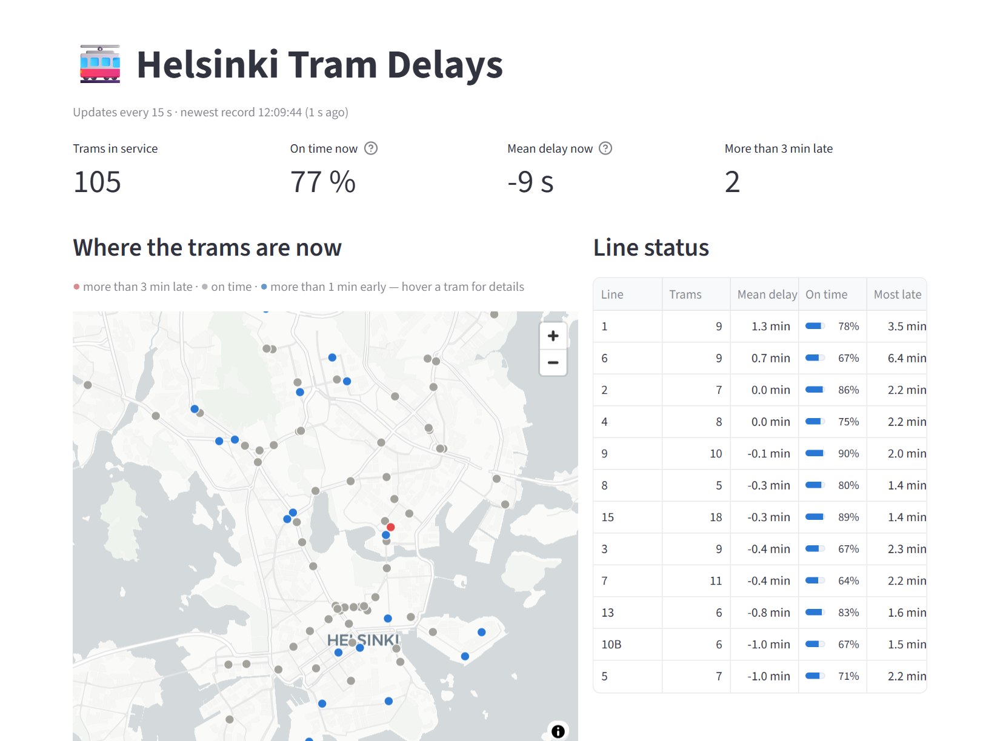
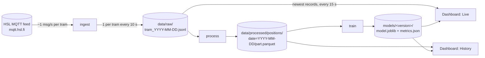
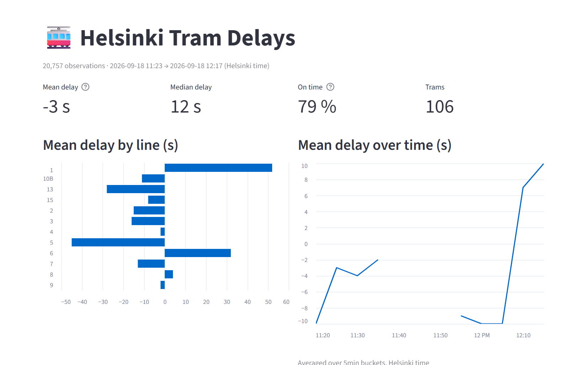
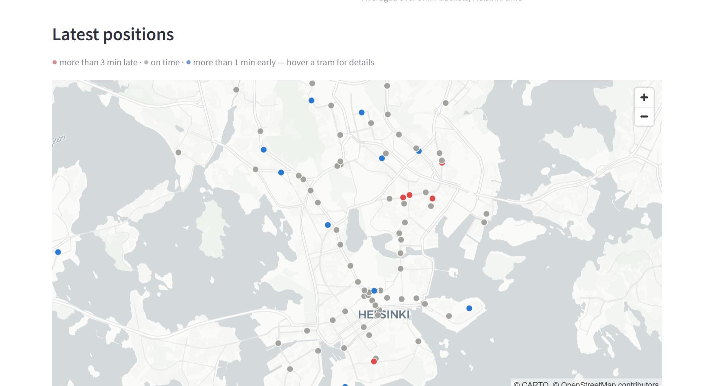
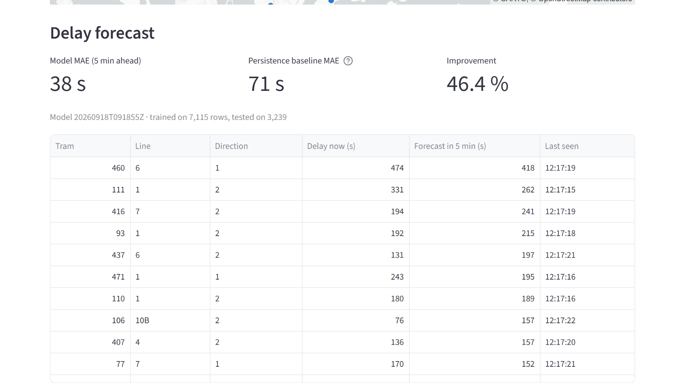
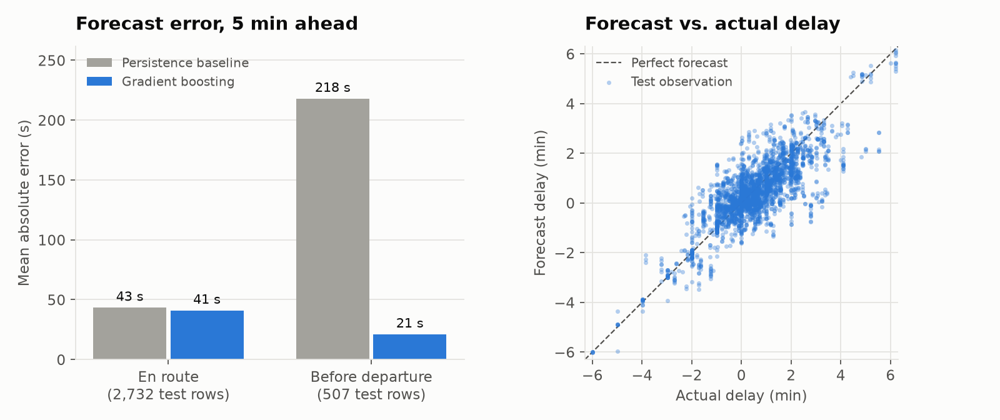
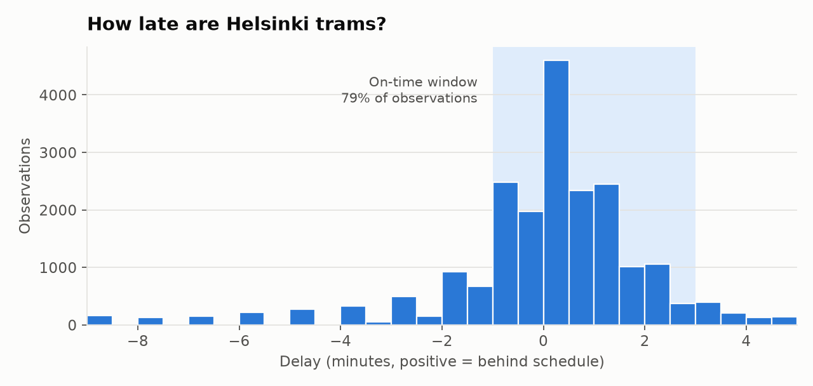
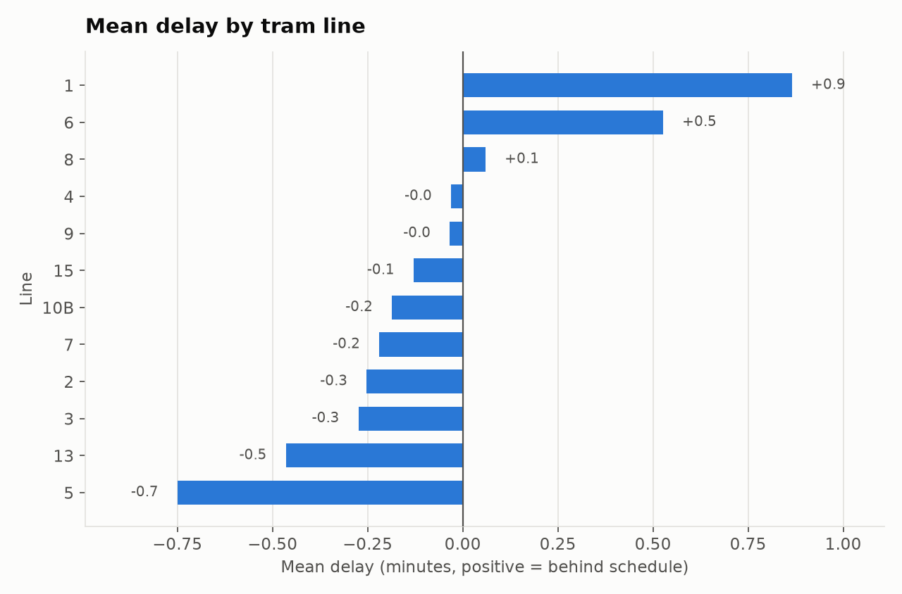

# 🚋 Helsinki Tram MLOps

[](https://github.com/girimohan/helsinki-tram-mlops/actions/workflows/ci.yml)


**Live dashboard: <https://fip-86-50-253-12.kaj.poutavm.fi>** (collector and dashboard running on CSC cPouta)

An end-to-end pipeline for real-time data and machine learning. It collects **live GPS positions of every tram in Helsinki**, cleans them into an analysis-ready dataset, trains a model that **forecasts each tram's delay 5 minutes ahead**, and serves everything in a **live dashboard** that refreshes every 15 seconds.



<sub>Live view on 18 Sep 2026, 12:09 (Helsinki time): 104 trams in service. Dot colours show trams running late, on time or early.</sub>

---

## Highlights

- **Real data, streamed live.** Subscribes to Helsinki Region Transport's public [high-frequency positioning feed](https://digitransit.fi/en/developers/apis/5-realtime-api/vehicle-positions/) over MQTT (about 100 messages per second).
- **Complete MLOps loop.** Ingest → process → train → versioned model → dashboard, with config files, tests, CI and Docker.
- **Honest evaluation.** The model is compared with a persistence baseline on a time-based split that prevents leakage, and results are broken down by segment. The breakdown exposes where the model really helps and where it barely does ([details](#model)).
- **Data-quality fixes found in the raw feed.** The feed uses an inverted sign for delay, contains stale journey sign-ins that look like 2‑hour delays, and delivers duplicate messages. Each is handled and covered by a test ([details](#data-quality-findings)).

## Contents

- [How it works](#how-it-works)
- [Quick start](#quick-start)
- [Dashboard](#dashboard)
- [Model](#model)
- [Data-quality findings](#data-quality-findings)
- [Project structure](#project-structure)
- [Configuration](#configuration)
- [Testing and CI](#testing-and-ci)
- [Roadmap](#roadmap)
- [Data and attribution](#data-and-attribution)

---

## How it works



| Stage | Command | What it does |
|---|---|---|
| **Ingest** | `python -m tram_mlops.ingest` | Subscribes to all tram positions over TLS, keeps one per tram every 10 s, and appends to one JSONL file per day. Also keeps every stop and journey event (arrivals, departures, journey sign-in and sign-off, traffic-light priority) in a separate daily file. Reconnects automatically if the connection drops. |
| **Forecast** | `python -m tram_mlops.forecaster` | Forecasts every tram's delay 5 min ahead every 15 s, logs the forecasts and scores each one against what happened 5 min later. `python -m tram_mlops.monitoring` prints the live accuracy against the persistence baseline. |
| **Archive GTFS-RT** | `python -m tram_mlops.gtfsrt` | Records HSL's service alerts and the tram part of its trip updates (HSL's own arrival predictions), keeping only what changed. Nobody else archives these feeds. |
| **Process** | `python -m tram_mlops.process` | Parses and deduplicates records, fixes the delay sign, removes stale journeys and converts times to Helsinki local time. Writes one Parquet partition per day with a fixed schema, and skips days that haven't changed since the last run (`--since`, `--rebuild` to reprocess). |
| **Train** | `python -m tram_mlops.train` | Builds features from the most recent days, splits by time, trains gradient boosting, compares it with the baseline, and saves a versioned model. |
| **Dashboard** | `streamlit run src/tram_mlops/dashboard.py` | A **Live** view that reads the ingester's newest data directly, and a **History** view that queries the day partitions with DuckDB, so it stays fast as weeks of data build up. |

## Quick start

Requires Python 3.11+.

```bash
git clone https://github.com/girimohan/helsinki-tram-mlops.git
cd helsinki-tram-mlops
python -m venv venv
source venv/bin/activate            # Windows: venv\Scripts\activate
pip install -r requirements.txt
pip install --no-deps -e .
```

Run the pipeline in separate terminals:

```bash
python -m tram_mlops.ingest                       # 1. collect live data (Ctrl+C to stop)
streamlit run src/tram_mlops/dashboard.py         # 2. open http://localhost:8501; Live view appears automatically

# after 30+ minutes of collection:
python -m tram_mlops.process                      # 3. build the dataset
python -m tram_mlops.train                        # 4. train and version a model
```

No time to collect? `process` falls back to a bundled sample: 45 continuous minutes of the weekday morning rush (all 119 trams, 1.2 MB). Both `process` and `train` work on a fresh clone, so the History view and the forecast panel work immediately.

### Docker

```bash
docker compose up -d ingest dashboard     # collector + dashboard on http://localhost:8501
docker compose run --rm pipeline          # process + train; run periodically, e.g. from cron
```

To run the collector around the clock on a cloud VM, see [deploy/cpouta/](deploy/cpouta/README.md) (CSC cPouta).

## Dashboard

Three pages, each with its own URL (`/`, `/history`, `/system`). A line filter in the sidebar applies to Live and History and is kept when you switch pages.

**Live** (`/`, screenshot at the top). It refreshes every 15 seconds and warns if the collector stops sending data. It shows:
- trams in service, the share on time and a live map coloured by punctuality
- a line-by-line status board
- live forecasts
- **HSL service alerts** for tram lines that are in force now: disruptive ones as banners, all of them in a list with their effect, cause, end time and link
- **disruptions per line** on the status board: ⚠️ alerts in force, and trips HSL has **cancelled** today (from GTFS-RT trip updates)

An alert counts as a tram alert when it names a tram route (including lettered variants such as `1011H`). Some alerts name only stops; those are assigned to the lines seen at those stops in the positions data. A bus alert that lists a shared stop is not counted.

**History** (`/history`): KPIs for a chosen range of days, then five sections. Only the open section is computed:
- **Overview:** on-time share and mean delay per service day, delay over time, and the delay distribution coloured early, on time and late
- **Lines:** a heatmap of on-time share by line and hour of day, and a reliability table per line (on time, mean and 90th-percentile delay, share more than 3 minutes late)
- **Time of day:** delay and punctuality by hour, weekdays against weekends
- **Trams:** the map of latest positions, the most delayed trams and the forecast panel (model accuracy against the baseline, and each tram's forecast delay 5 minutes ahead)
- **Stops:** arrival delay at each stop over the last 24 hours, computed from HFP stop events (arrival time minus scheduled arrival), on a map and as a table of the latest-running stops

**System** (`/system`): the production side of the pipeline:
- a diagram of the services
- the freshness and volume of every source today: positions, stop events, trip updates and alerts, each flagged 🟢 live or 🟠 stale
- the stop events by type
- every processing run, with the rows kept and the rows dropped under each cleaning rule
- the deployed model
- data on disk







**Memory.** The container is capped at 1 GB, so every page aggregates in DuckDB and never loads days of rows into pandas. History queries the processed Parquet partitions, and stop events and trip updates are scanned straight from the raw files with only the needed columns. Results are cached: processed data until the next processing run (the cache key includes the manifest's modification time), raw feeds for 5 minutes.

## Model

**Task:** predict a tram's delay 5 minutes ahead on the same journey.

**Baseline:** *persistence*, which assumes the delay stays as it is now. It is the natural benchmark for short-term forecasting and is surprisingly hard to beat.

**Model:** `HistGradientBoostingRegressor` (scikit-learn), which predicts the *change* in delay. Features include the current delay, the delay trend over the last 60 s, time since the scheduled departure, speed, whether doors are open or the tram is at a stop, position, line and direction, and time of day. Every feature uses only current and past observations.

**Evaluation:** a time-based split. The model trains on earlier data and is tested on the last 25%. Training rows whose 5‑minute target would fall inside the test period are removed. Without that purge, a first run overstated the improvement (45% instead of 32% on the same data).

### Results

The model was trained on 35 minutes of live data collected in two sessions on 18 Sep 2026 (7,115 training rows, 3,239 test rows, 105 trams).

| 5‑min‑ahead forecast | Test rows | Baseline MAE | Model MAE | Improvement |
|---|---:|---:|---:|---:|
| All observations | 3,239 | 70.7 s | **37.9 s** | 46% |
| En route (tram has departed) | 2,732 | 43.4 s | **41.0 s** | 5% |
| Before departure (waiting at terminus) | 507 | 218.0 s | **21.1 s** | 90% |



**What this means:** the headline 46% is real but **mostly comes from trams that haven't departed yet.** A tram waiting at its terminus reports a large "early" offset until it leaves, which the baseline takes at face value. The model learns this pattern: *time since scheduled departure* is its most important feature by permutation importance. **For trams already moving, the model is only slightly better than the baseline.** Improving that segment needs weeks of data covering different times of day, weekdays and weather. Every training run records this breakdown in `metrics.json`.

## Data-quality findings

Exploring the raw feed turned up several problems that silently distort results if left in. Each fix is covered by a test.

| Finding | Impact | Fix |
|---|---|---|
| HSL's `dl` field is **positive when a tram is *ahead*** of schedule | The original analysis reported every delay with the wrong sign | `delay_s = -dl`, so positive means late |
| Some trams stay **signed into a journey hours after it ended** | 913 of 21,948 rows (4%) show fake delays of 1–2.5 h; in the first live run they pushed the mean delay to **+237 s instead of −3 s** | Drop rows where \|delay\| > 30 min (configurable) |
| The broker can **deliver the same message twice** | The first sample file contained every record twice | Deduplicate on (tram, timestamp) |
| Line **"000"** (route `1009TX`) is not a public line | It appeared as the most delayed "line" in the first live run | Excluded through `exclude_lines` in config |
| Timestamps are **UTC** | Hour-of-day charts were shifted by 2–3 hours | Converted to `Europe/Helsinki` |





<sub>Figures are based on 20,757 observations from 18 Sep 2026, 11:23–12:17 Helsinki time (collection paused 11:38–11:58). Mean delay −3 s, median +12 s, 79% within the on-time window of 1 min early to 3 min late.</sub>

## Project structure

```
helsinki-tram-mlops/
├── src/tram_mlops/
│   ├── ingest.py        # MQTT collector: positions + stop events → daily JSONL
│   ├── gtfsrt.py        # archiver for HSL service alerts and tram trip updates
│   ├── forecaster.py    # live forecasts, logged and scored 5 min later
│   ├── monitoring.py    # live accuracy: rolling MAE vs persistence, by segment
│   ├── process.py       # cleaning, deduplication, incremental runs, live tail reader
│   ├── storage.py       # day partitions, fixed schema, manifest, raw compaction
│   ├── history.py       # DuckDB aggregates for the History view
│   ├── features.py      # leakage-free features and 5-min-ahead target
│   ├── train.py         # time split, model, baseline, versioning
│   ├── dashboard.py     # Streamlit app (Live + History)
│   └── config.py        # TOML config with env-var overrides
├── configs/config.toml  # every tunable setting
├── tests/               # 64 pytest tests, including dashboard and end-to-end pipeline tests
├── scripts/             # sample cutter, README figures and screenshots
├── data/sample/         # 45-min sample of real data (10 Nov 2026, 07:30–08:15)
├── docs/                # ROADMAP.md, README figures and screenshots
├── deploy/cpouta/       # cloud VM setup guide and script
├── Dockerfile, docker-compose.yml
└── .github/workflows/ci.yml
```

## Configuration

All settings live in [`configs/config.toml`](configs/config.toml): sampling interval, on-time window, outlier threshold, forecast horizon, dashboard refresh rate and more. You can override any of them without editing the file by setting an environment variable named `TRAM_<SECTION>_<KEY>`:

```bash
TRAM_MODEL_HORIZON_S=600 python -m tram_mlops.train      # 10-minute forecast
TRAM_INGEST_SAMPLE_INTERVAL_S=5 python -m tram_mlops.ingest
```

## Testing and CI

```bash
pip install -r requirements-dev.txt   # pinned test, lint and type-check tools
pytest --cov                          # 64 tests, about 30 s; fails below 80% coverage
ruff check src tests scripts
mypy
pre-commit install                    # run ruff, mypy and file checks on every commit
```

`make check` runs all of them plus the pipeline (on Linux or macOS).

The tests cover the delay sign convention, deduplication, outlier and line filtering, time zones, and leakage-free target construction. They also cover the purged time split, segment metrics, reading the tail of a file that's still being written (including across UTC midnight), the ingester's downsampling and daily file rollover, and the dashboard in both modes. The dashboard tests use Streamlit's headless `AppTest`. An end-to-end test runs `process` then `train` on the bundled sample and checks that the model beats persistence, both overall and for trams already en route.

GitHub Actions runs on every push and pull request:
- **lint:** ruff and mypy
- **test:** pytest with coverage on Python 3.11 and 3.13, then the `process` → `train` command-line run a fresh clone would do
- **docker:** builds the image and processes the sample inside it as its non-root user

The server deploys a commit only after all of these pass ([deploy/cpouta/](deploy/cpouta/README.md)).

The sample is cut from a real collection day with `scripts/make_sample.py`, which streams the raw file and runs on the server next to it.

To regenerate this README's figures and screenshots:

```bash
pip install -e ".[docs]"
python scripts/make_figures.py
python scripts/screenshot_dashboard.py     # drives your installed Chrome; run while the collector is on to capture the Live view
```

## Roadmap

The engineering plan (storage, evaluation, retraining, monitoring, serving) is in [docs/ROADMAP.md](docs/ROADMAP.md). Product ideas:

- **More data.** Run the collector for several weeks so the model sees rush hours, weekends and weather. This is the main lever for the en-route forecast.
- **Reliability per stop, line and hour.** For example: "Line 7 at Senaatintori, weekdays 8–9 am: on time 62% of the time." The HSL app shows the current delay but not how reliable a line *usually* is.
- **"When should I leave?"** For a chosen stop and arrival deadline, suggest a departure time that is on time 90% of the time, based on past delays.
- **Where delays build up.** Map the street segments where trams lose time, useful input for tram signal priority.
- **Production operations.** Scheduled retraining, promoting a new model only when it beats the current one, drift monitoring and a database instead of files.

## Data and attribution

Vehicle position data: © [Helsinki Region Transport (HSL)](https://www.hsl.fi/en/hsl/open-data), licensed under [CC BY 4.0](https://creativecommons.org/licenses/by/4.0/). Map tiles © [CARTO](https://carto.com/attributions), © [OpenStreetMap](https://www.openstreetmap.org/copyright) contributors.
